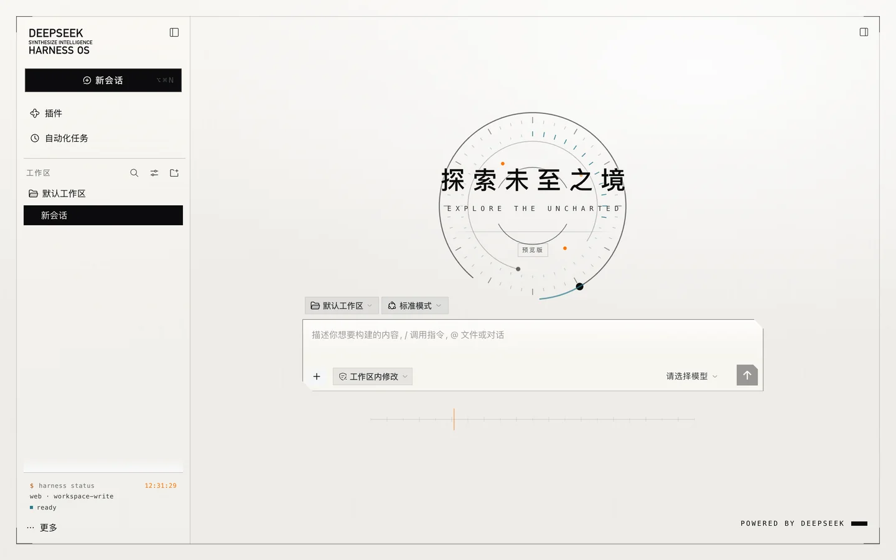
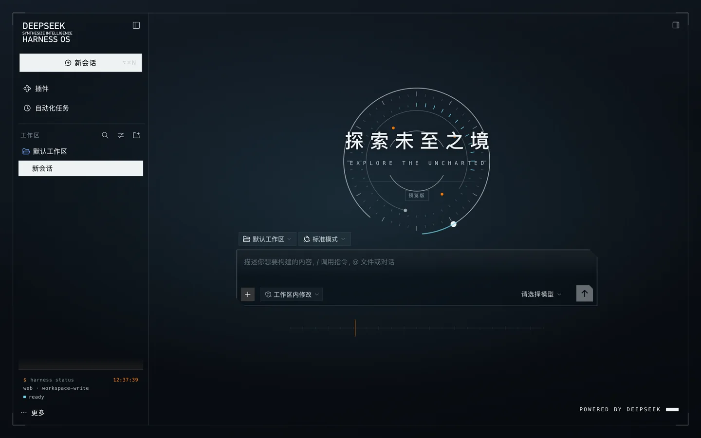
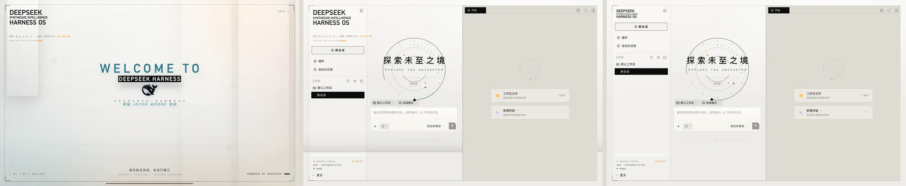
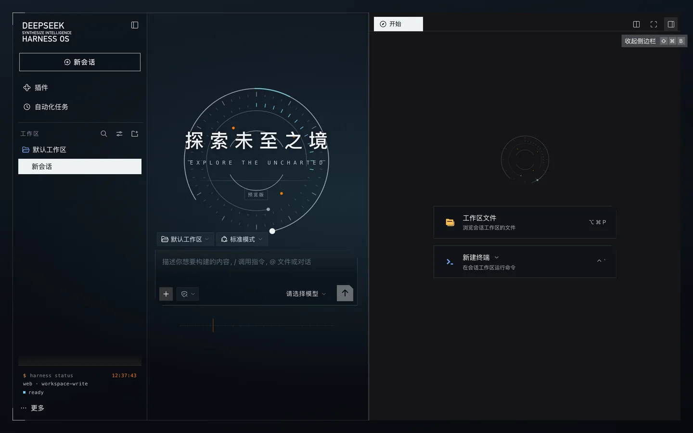
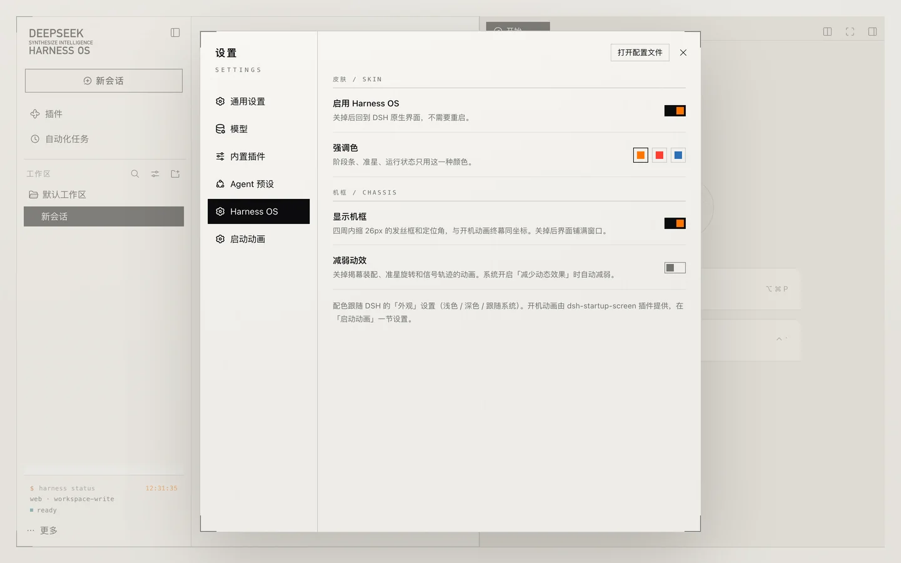
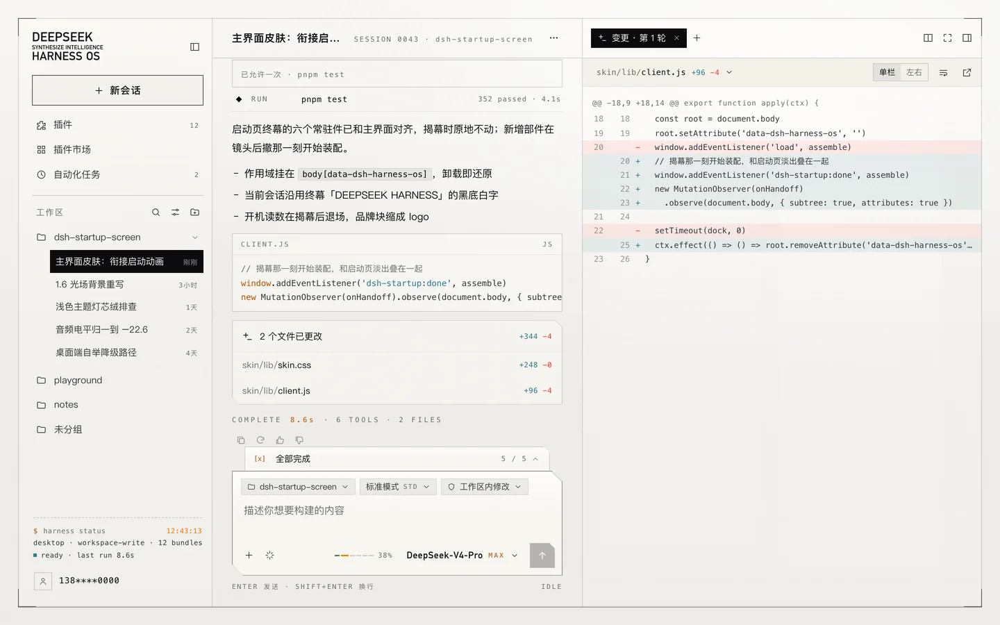

<h1 align="center">Harness OS</h1>

<p align="center">DeepSeek Harness 的主界面皮肤：把开机动画的「技术档案」版式延伸到整个工作台。</p>

<p align="center">
  
  
</p>

这个仓库有两个 DSH 插件，配合使用：

| 包 | 作用 | 来源 |
|---|---|---|
| [`dsh-harness-os`](packages/dsh-harness-os) | 主界面皮肤：底板、机框、品牌块、准星罗盘、侧栏 / 输入卡 / 对话流 / 右侧栏 / 菜单 / 设置页的整套样式 | 本仓库新写 |
| [`dsh-startup-screen`](packages/dsh-startup-screen) | 开机动画 | **fork 自 [QIFANAI/dsh-startup-screen](https://github.com/QIFANAI/dsh-startup-screen)**（原作者沈宏宏，MIT），只加了一个揭幕事件，见 [FORK.md](packages/dsh-startup-screen/FORK.md) |

> 主界面的版式、配色、准星几何和底板配方都取自 dsh-startup-screen。没有这个开机动画，就没有这套皮肤。

## 和开机动画无缝衔接

开机动画终幕留在屏幕上的几样东西是底板、机框、左上品牌块、REV 与时钟、六格阶段条和右下页脚。皮肤把它们放在**同一坐标**上，
所以镜头后撤、开机动画淡出时，这些部件原地不动；其余部件在揭幕那一刻按开机动画的节奏装配进来，准星从开机尺寸收进空会话页。
约 1.5 秒后，开机读数退场，品牌块缩成 logo。

<p align="center"></p>

## 界面

<p align="center">
  
  
</p>

- **主题变量**：覆盖 DSH 的 `--dsw-alias-*` 别名 token（底色、描边、文字、按钮、菜单、提示、代码对比……），浅色是开机动画的暖白底板，暗色是同一套的暗底板，跟随 DSH 的「外观」设置。
- **机框**：四周内缩 26px 的发丝框和四个定位角，与开机动画终幕同坐标。可以在设置里关掉。
- **侧栏**：品牌块、擦入式「新会话」按钮、当前会话用终幕那块黑底白字；底部三行伪代码状态（profile、权限、模型、运行计时）。
- **空会话页**：「探索未至之境」改成开机动画中央读数的版式，背后是准星，下方一条信号轨迹。
- **输入卡、对话流、右侧栏、菜单、设置页**：统一成直角与切角、发丝边、等宽小字的档案风格，橙色只留给状态。

对话流的样子可以看 demo（下图是 demo 截图，不是真实会话）：

<p align="center"></p>

## 安装

需要 DeepSeek Harness 0.2.x。两个插件都装，开机动画用本仓库的 fork（和上游同名，装上会替换上游版本）。

**桌面端**：先**完全退出** DeepSeek Harness（profile 由桌面端独占），再执行：

```bash
dsh plugin --profile desktop add "github:TinyNian/dsh-harness-os#path:packages/dsh-startup-screen"
dsh plugin --profile desktop add "github:TinyNian/dsh-harness-os#path:packages/dsh-harness-os"
```

**Web**：把 `--profile desktop` 换成 `--profile web`，装完重启 `dsh web`。

> macOS 桌面端自带的命令行在 `/Applications/DeepSeek Harness.app/Contents/Resources/runtime/cli/bin/dsh`，版本和桌面端一致。

只想要皮肤、不要开机动画也可以，只装第二条。没有开机动画时皮肤直接停在收起态。

卸载：

```bash
dsh plugin --profile desktop remove dsh-harness-os
dsh plugin --profile desktop remove dsh-startup-screen
```

## 设置

- **设置 → Harness OS**：启用 / 强调色（橙、信号红、冰蓝）/ 显示机框 / 减弱动效。改完立即生效，不用重启。
- **设置 → 启动动画**：开机动画自己的设置（身份名称、主题、速度、语音……），见 [fork 的 README](packages/dsh-startup-screen/README.md)。
  建议把开机动画的主题和 DSH 的外观设成一致，揭幕时底板颜色才接得上。

## 兼容性与已知限制

- 在 **DSH 0.2.1-rc.2** 上实测过：web profile（macOS，Chrome）与 **macOS 桌面端**（已实装日常使用）。揭幕衔接、侧栏与折叠动画、空会话页、对话流、右侧栏、菜单、设置页都对上。
- macOS 桌面端为红绿灯和顶栏按钮在机框上留了缺口，并用皮肤底板替代原生毛玻璃窗口背景。**Windows 桌面端**还没有实机验证，标题栏按钮区域和机框的配合可能需要调整。
- 皮肤靠 DSH 的 `data-slot` 和 CSS Modules 语义类名（如 `_newSession`）定位元素。DSH 改了结构时，对应部分会退回原生样式，不会让界面坏掉。
- 和其他整套皮肤（比如深海女仆工坊）不要同时启用。

## 仓库结构

```text
├─ packages/
│  ├─ dsh-harness-os/       主界面皮肤（client.js 手写 ModuleLoader bundle，无需构建）
│  └─ dsh-startup-screen/   开机动画（fork，FORK.md 记录来源和改动）
├─ demo/                    可交互的 HTML demo：开机动画 → 主界面 → 对话 / 右侧栏 / 设置页
└─ docs/screenshots/
```

## 开发

```bash
# 本地链接安装（改完刷新页面即可看到皮肤变化；改了 package.json 要重启 dsh）
dsh plugin --profile web add "link:$PWD/packages/dsh-startup-screen" "link:$PWD/packages/dsh-harness-os"

# 测试：皮肤冒烟 + 开机动画上游的 352 项断言
npm test

# demo：在仓库根目录起静态服务，打开 http://localhost:8080/demo/
npm run demo
```

demo 支持几个参数：`?splash=0` 跳过开机动画，`?theme=dark`，`?run=1` 自动演示一轮对话，`?dock=files|review|terminal` 打开右侧栏。

## 致谢与许可

- 开机动画 fork 自 [QIFANAI/dsh-startup-screen](https://github.com/QIFANAI/dsh-startup-screen) v1.6.0（提交 `8499f9d`）。
  原始版本由**沈宏宏**以 MIT 发布，后续由 dsh-startup-screen contributors 维护。版权声明原样保留在 [packages/dsh-startup-screen/LICENSE](packages/dsh-startup-screen/LICENSE)。
- 开机动画不附带原片台词、原片音效与商业 BGM，素材边界见 [THIRD-PARTY-NOTICES.md](packages/dsh-startup-screen/THIRD-PARTY-NOTICES.md)。
- 本项目是社区作品，与 DeepSeek / 深度求索无隶属关系，未获官方背书。「DeepSeek」名称与鲸鱼标识归深度求索所有。
- 皮肤与 demo 代码：[MIT](LICENSE) © 2026 TinyNian。
